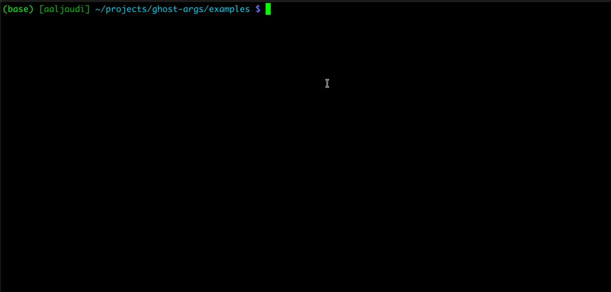

<div align="center">

# 👻 Ghost Args

**Your scripts. Their arguments. Right where you type.**

[](docs/guide.md)

[](LICENSE)
[](https://github.com/aaljoudi/ghost-args/actions/workflows/ci.yml)

Argument hints for Zsh, made by [Abdulrahman Aljoudi (@aaljoudi)](https://github.com/aaljoudi).

</div>



Hints appear as dim ghost text as you type. They never become part of your command.

## ⚡ Install

```sh
curl -fsSL https://raw.githubusercontent.com/aaljoudi/ghost-args/main/install.sh | sh
exec zsh
```

**Zsh 5.3+ · macOS & Linux · No sudo or runtime dependencies.**
Your `.zshrc` is backed up automatically. To update, run the same command again.

## ✨ Use it

Put a usage comment on **line 2** of any executable script:

```sh
#!/bin/sh
# ./greet <name> <greeting>
printf '%s, %s!\n' "$2" "$1"
```

Save as `greet`, run `chmod +x greet`, then type `./greet` in Zsh. The remaining arguments appear automatically—no configuration needed.

Works with quoted paths, commands on `PATH`, pipelines, and common redirections. Hints are positional; they do not validate options or values.

## 🎨 Make it yours

Add this **before** the plugin's source block in `.zshrc`:

```zsh
SCRIPT_ARG_HINT_STYLE='fg=cyan'  # default: fg=8 (gray)
```

## 🧹 Uninstall

```sh
curl -fsSL https://raw.githubusercontent.com/aaljoudi/ghost-args/main/install.sh | sh -s -- uninstall
exec zsh
```

**No hints?** Check that you're in Zsh, the script is executable, and line 2 names the same script. Keep the cursor at the end. Usage hints appear automatically, including with `zsh-autosuggestions`.

---

[Guide & troubleshooting](docs/guide.md) · [Contributing](CONTRIBUTING.md) · [Changelog](CHANGELOG.md) · [Security](SECURITY.md) · [MIT license](LICENSE)
